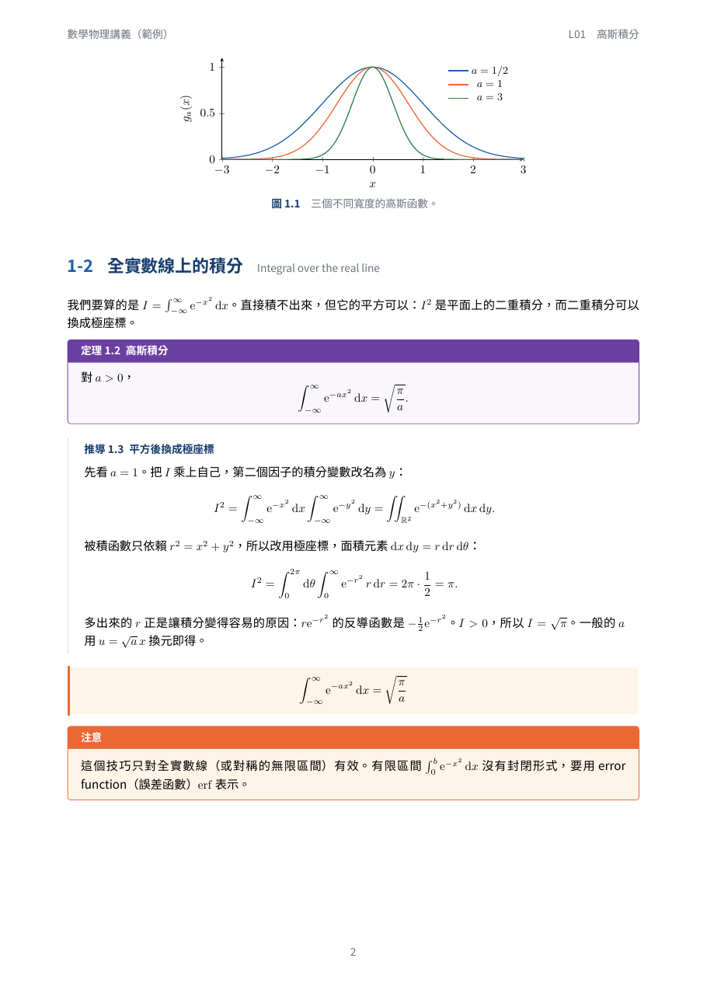
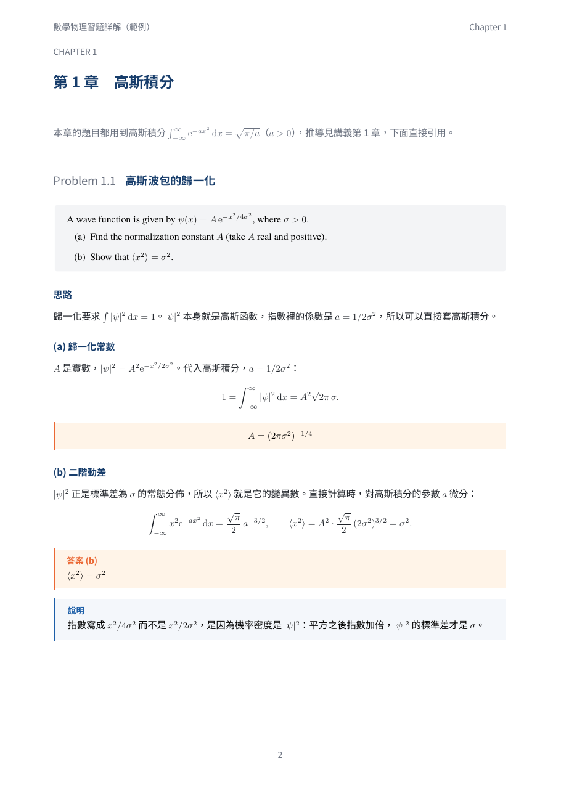

# LaTeX Lecture Templates · 中文理工講義與習題詳解 LaTeX 版型

**English** | [繁體中文](README.zh-TW.md)

[](LICENSE) [](https://github.com/Celivem/latex-lecture-templates/releases) 

Two XeLaTeX templates for Traditional Chinese science and engineering course materials:

- **`styles/codex_notes.tex`** for lecture notes: chapter header, numbered sections with an English subtitle, definition / theorem / derivation / example blocks that share one numbering sequence, key-result boxes, a chapter-question box, notes and extension boxes.
- **`styles/codex_solutions.tex`** for worked solutions: chapter header, problem headings listed in the table of contents, the original English problem statement in a grey serif box, Chinese solution text with result boxes and note boxes.

Both share one look: A4, 10 pt `article`, 2 cm margins, line spacing 1.3, Noto Sans TC for both Chinese and Latin text, no paragraph indentation, navy headings, blue accents and light-orange key-result boxes.

| Notes `codex_notes.tex` | Solutions `codex_solutions.tex` |
|---|---|
|  |  |

## Contents

- [Requirements](#requirements)
- [Fonts](#fonts)
- [Quick start](#quick-start)
- [Using the templates in your own files](#using-the-templates-in-your-own-files)
- [Lecture notes template reference](#lecture-notes-template-reference)
- [Worked solutions template reference](#worked-solutions-template-reference)
- [Colours](#colours)
- [Typographic details](#typographic-details)
- [Project structure](#project-structure)
- [Testing](#testing)
- [Troubleshooting](#troubleshooting)
- [Versions](#versions)
- [Citing](#citing)
- [License](#license)

## Requirements

- **XeLaTeX.** The templates use `fontspec` and `xeCJK`, so pdfLaTeX and LuaLaTeX are not supported. The examples compile with TeX Live 2026.
- **LaTeX packages** (all in a standard TeX Live installation):
  - both templates: `fontspec`, `xeCJK`, `amsmath`, `amssymb`, `amsthm`, `mathtools`, `geometry`, `booktabs`, `longtable`, `array`, `tabularx`, `graphicx`, `float`, `enumitem`, `setspace`, `xcolor`, `fancyhdr`, `needspace`, `tcolorbox` (with the `most` library), `titlesec`, `titletoc`, `hyperref`;
  - notes template in addition: `etoolbox`, `caption`, `tikz`, `pgfplots` (with `compat=1.18`, so pgfplots 1.18 or newer), TikZ libraries `arrows.meta`, `calc`, `positioning`, `decorations.pathreplacing`, pgfplots library `fillbetween`;
  - solutions template in addition: the TeX Gyre Termes OpenType fonts (`texgyretermes-*.otf`), included in TeX Live.
- **Noto Sans TC** (`NotoSansTC-Regular.ttf`, `NotoSansTC-Bold.ttf`), see below.

## Fonts

Download [Noto Sans TC](https://fonts.google.com/noto/specimen/Noto+Sans+TC) (SIL Open Font License) and copy these two files from the archive's `static/` folder into `fonts/`:

- `NotoSansTC-Regular.ttf`
- `NotoSansTC-Bold.ttf`

The font files are not under version control (see [fonts/README.md](fonts/README.md)).

The folder is given by the macro `\codexfontpath`, which must end with `/`. Define it **before** loading a template:

```latex
\def\codexfontpath{C:/path/to/Noto_Sans_TC/static/}
```

- A relative path such as `../fonts/` is resolved from the directory in which XeLaTeX runs.
- If `\codexfontpath` is set to empty, the font files are looked up by name in the TeX search path and the current folder.
- `codex_notes.tex` falls back to a built-in default folder that exists only on the author's machine, so always define `\codexfontpath` yourself (the examples do).
- `codex_solutions.tex` does not set fonts itself: it runs `\input{fonts.tex}`, and TeX finds that file in the current directory or the TeX search path. [examples/fonts.tex](examples/fonts.tex) is a ready-to-use copy that also reads `\codexfontpath` (default `../fonts/`).

Font roles: Noto Sans TC Regular is the main, CJK, italic and monospace font; Noto Sans TC Bold is the bold and bold-italic font. Italic text is therefore set upright. The English problem box of the solutions template uses TeX Gyre Termes (regular, bold, italic, bold italic, scaled 1.04).

## Quick start

1. Put `NotoSansTC-Regular.ttf` and `NotoSansTC-Bold.ttf` into `fonts/`.
2. Compile the examples from inside `examples/`:

   ```bash
   cd examples
   latexmk -xelatex notes_example.tex
   latexmk -xelatex solutions_example.tex
   ```

   To keep auxiliary files out of `examples/`, add `-outdir=../build` (the `build/` folder is ignored by git). Each example produces a 3-page PDF.

[examples/notes_example.tex](examples/notes_example.tex) (a short chapter on the Gaussian integral) and [examples/solutions_example.tex](examples/solutions_example.tex) (two worked problems) use most features and can be copied as starting points.

## Using the templates in your own files

### Lecture notes

```latex
\documentclass[10pt,a4paper]{article}
\providecommand{\codexfontpath}{../fonts/}   % font folder, ends with /
\newcommand{\coursename}{數學物理講義}        % left side of the page header
% optional parameters go here (see below)
\input{../styles/codex_notes.tex}
\setuplecture{1}{高斯積分}   % chapter number and title
\coursekeepblocks            % optional: keep section titles off the page bottom

\begin{document}
\thispagestyle{empty}
\lecturehead{\coursename\quad L01}{高斯積分}
\tableofcontents
\booksection{高斯函數}{The Gaussian function}
...
\end{document}
```

### Worked solutions

```latex
\documentclass[10pt,a4paper]{article}
\providecommand{\codexfontpath}{../fonts/}
\input{../styles/codex_solutions.tex}       % reads fonts.tex from the current folder
\courseheader{數學物理習題詳解}{Chapter 1}

\begin{document}
\tableofcontents
\chapterhead{CHAPTER 1}{第 1 章　高斯積分}
\problem{1.1}{高斯波包的歸一化}
\begin{statement}
A wave function is given by ...
\end{statement}
\subsection*{思路}
...
\keyresult{$A=(2\pi\sigma^2)^{-1/4}$}
\end{document}
```

The paths `../styles/` and `../fonts/` assume the layout of this repository; adjust them to wherever you keep the files.

## Lecture notes template reference

### Setup

| Command | Where | Effect |
|---|---|---|
| `\coursename` | define before `\input` (needed by `\setuplecture`) | Course name, printed on the left of the page header |
| `\setuplecture{n}{title}` | after `\input` | Sets the chapter number and title. Sections are numbered `n-1, n-2, …`; equations, figures, tables and blocks `(n.1), (n.2), …`; the page header shows `\coursename` on the left and `L0n  title` on the right |
| `\coursekeepblocks` | after `\input` | Before every `\section` it requires 12 lines of space and before every `\subsection` 8 lines (via `\Needspace*`), otherwise starts a new page |

Without `\setuplecture` there is no page header and blocks are numbered `0.k`. The footer always shows the page number, centred in grey.

### Optional parameters (define before `\input`)

| Macro | Default | Meaning |
|---|---|---|
| `\codexfontpath` | author's local folder | Font folder, see [Fonts](#fonts) |
| `\codexsecsep` | `-` | Separator between chapter and section number (`1-2`) |
| `\codexlecturetag` | `L01`, `L02`, … | One-argument macro that formats the chapter tag in the header, e.g. `\newcommand{\codexlecturetag}[1]{第#1講}` |
| `\codextoclabelwidth` | `2.6em` | Width reserved for section numbers in the table of contents |

### Headings and title

| Command | Output |
|---|---|
| `\lecturehead{small line}{chapter title}` | Chapter header in place of `\maketitle`: a small grey line, the title in 18 pt bold navy, and a thin rule |
| `\booksection{中文標題}{English title}` | Numbered section. The English subtitle is set in small grey type on the same line when it fits, otherwise moved as a whole to the next line; very long subtitles are set without hyphenation. Only the Chinese title goes into the table of contents |
| `\plainsection{title}` | Unnumbered section that still appears in the table of contents (introduction, summary) |
| `\section`, `\subsection` | Standard commands; sections are Large bold navy with a blue number, subsections bold navy without a number |
| `\tableofcontents` | Titled 目錄; lists sections only (`tocdepth` 1), with dotted leaders |

### Blocks

`definition`, `theorem`, `derivation` and `example` share one counter, so in chapter 1 they are numbered 1.1, 1.2, 1.3, … in order of appearance. All of them take an optional title `[...]`, can break across pages, and a `\label` placed inside one refers to the block number.

| Environment / command | Appearance |
|---|---|
| `\begin{definition}[title]` | Box with blue title bar 「定義 n.k title」 |
| `\begin{theorem}[title]` | Box with purple title bar 「定理 n.k title」 |
| `\begin{derivation}[title]` | No frame; thin grey line on the left, heading 「推導 n.k title」 |
| `\begin{example}[title]` | No frame; green line on the left, heading 「例 n.k title」 |
| `\begin{solution}` | Solution of an example, placed after `example`: green 「解」 label, no box |
| `\begin{note}[title]` | Orange box titled 「注意 title」 (not numbered) |
| `\begin{extension}[title]` | Grey box, small grey text, heading 「延伸 title」 (not numbered) |
| `\chaptergoal{text}` | Grey box headed 「本章問題」 for the chapter's opening question |
| `\keyresult{math}` | Centred key result in a light-orange box with an orange bar on the left. The argument is **math only**: it is typeset as `$\displaystyle ...$` |

Before `example` and `derivation` the template requires 6 lines of space, before `definition` and `theorem` 5 lines, so a block heading does not end up alone at the bottom of a page.

### Other settings

- Captions: 「圖」 and 「表」 as figure and table names; small grey caption text with a bold navy label.
- Lists: blue bullets for `itemize`, blue `1.` numbers for `enumerate`.
- Paragraph spacing 0.55 em, no indentation, widows and clubs prevented, `\raggedbottom`, display breaks allowed (`\allowdisplaybreaks[2]`).
- Links: `hyperref` with coloured links (navy internal, blue URLs and citations).
- `\pgfplotsset{compat=1.18}` is set, so `tikzpicture` / `axis` plots work directly (see the figure in the notes example).

### Notation macros

| Macro | Result |
|---|---|
| `\dd` | Upright differential d with correct spacing: `\dd x` |
| `\e` | Upright e |
| `\avg{x}` | $`\langle x\rangle`$ with auto-sized brackets |
| `\Order` | Calligraphic O for order of magnitude |

## Worked solutions template reference

### Setup

| Command | Effect |
|---|---|
| `\courseheader{left}{right}` | Page header text, small grey, left and right |
| `\codexsolutionsprehyperref` | Optional; define before `\input` as e.g. `\def\codexsolutionsprehyperref{\RequirePackage{siunitx}}` to load packages that must come before `hyperref` |

The footer shows the centred page number. There is no automatic section numbering.

### Headings

| Command | Output |
|---|---|
| `\chapterhead{CHAPTER 1}{第 1 章　章名}` | Starts a new page; small grey line, title in 16 pt bold navy, thin rule. Added to the table of contents as a chapter-level entry (bold blue) |
| `\problem{1.1}{中文題名}` | Problem heading "Problem 1.1" (grey) followed by the title (large bold navy). Requires 10 lines of space or starts a new page. Added to the table of contents as an indented entry |
| `\subsection*{思路}`, `\subsubsection*{...}`, `\paragraph{...}` | Sub-headings inside a solution: bold navy; `\paragraph` is run-in. Use the starred forms, so only chapters and problems appear in the table of contents |
| `\tableofcontents` | Titled 目錄; page-number column widened (2.2 em) so three-digit page numbers fit |

### Boxes

| Environment / command | Appearance |
|---|---|
| `\begin{chapterintro}` | Chapter introduction in grey text |
| `\begin{statement}` | The original English problem in a light-grey box set in TeX Gyre Termes. It can break across pages; continuation parts are marked 「（續）」 in the top-right corner |
| `\begin{resultbox}[label]` | Light-orange box with an orange bar on the left; the optional label (e.g. `[答案 (b)]`) is printed in small bold orange above the content. Does not break across pages |
| `\keyresult{text}` | In text mode: the argument is centred inside a `resultbox`, so write math as `$...$` (e.g. `\keyresult{$A=1$}`). In math mode: the formula is highlighted with an orange background (`\tcbhighmath`) |
| `\begin{notebox}[title]` | Light-blue box with a blue bar, title default 「說明」; can break across pages |

### Notation macros

`\dd` and `\e` as in the notes template. `\avg` and `\Order` are only defined in the notes template.

## Colours

Both templates define these `xcolor` names, which you can use in your own text and figures:

| Name | Hex | Used for |
|---|---|---|
| `qblue` | `#1D5FA8` | Section numbers, list markers, TOC chapter entries, definition boxes, note boxes (solutions) |
| `qnavy` | `#173D6B` | Headings, links |
| `qorange` | `#EB6834` | Result-box bar, note-box title (notes) |
| `qorangebg` | `#FFF4E8` | Result-box background |
| `qgraybg` | `#F3F4F6` | Problem statement, chapter-goal and extension backgrounds |
| `qrule` | `#D8DDE3` | Thin rules, derivation line |
| `qmuted` | `#6B7280` | Secondary text, header and footer |
| `qtext` | `#1F2329` | Body text |

The notes template adds `qgreen` (`#2E7D4F`, examples and solutions) and `qpurple` (`#6B3FA0`, theorems), plus the aliases `qgray` (= `qmuted`) and `qlight` (= `qgraybg`). The solutions template adds `qgraybar` (`#8A929C`).

## Typographic details

- **English apostrophes.** XeCJK normally treats `‘ ’` (U+2018/U+2019) as full-width CJK punctuation, and Noto Sans TC's glyphs for them are full width, which leaves a gap in words like *Ampère's*. Both templates declare these two characters as Western characters and switch on proportional-width glyphs (`+pwid`) for the main font. Chinese punctuation is unaffected; use 「」 for Chinese quotation marks.
- **Colour after page-breaking boxes (notes).** When a breakable box ends exactly at the bottom of a page, the colour stack of `xdvipdfmx` can get out of step and turn the following text white. The notes template resets the text colour after each `definition`, `theorem`, `note`, `derivation`, `example` and `extension`.
- **Labels inside numbered boxes (notes).** `\label` inside a numbered block records the block number (`1.3`) rather than the surrounding section number.

## Project structure

```
.
├── styles/
│   ├── codex_notes.tex        # lecture notes template
│   └── codex_solutions.tex    # worked solutions template
├── examples/
│   ├── notes_example.tex      # notes example (Gaussian integral chapter)
│   ├── solutions_example.tex  # solutions example (two problems)
│   └── fonts.tex              # font setup read by codex_solutions.tex
├── fonts/
│   └── README.md              # where to get the font files (fonts themselves not tracked)
├── docs/
│   ├── notes_preview.png
│   └── solutions_preview.png
├── LICENSE                    # MIT
├── README.md                  # this file (English)
└── README.zh-TW.md            # Traditional Chinese README
```

`.gitignore` excludes the font files, `build/`, LaTeX auxiliary files and the PDFs generated in `examples/`.

## Testing

There is no automated test suite. The check is to compile both examples (see [Quick start](#quick-start)); with TeX Live 2026 both compile without errors to 3-page PDFs (the solutions example logs one `hyperref` warning about a bookmark anchor).

## Troubleshooting

| Problem | Cause and fix |
|---|---|
| `The font "NotoSansTC-Regular" cannot be found` | `\codexfontpath` is not set, does not end with `/`, or a relative path does not match the folder XeLaTeX runs in. Define it before `\input`. |
| `File 'fonts.tex' not found` (solutions) | The solutions template reads `fonts.tex` from the current directory or the TeX search path. Copy `examples/fonts.tex` next to your main file. |
| `Undefined control sequence \coursename` | Define `\coursename` when using `\setuplecture`. |
| Blocks are numbered 0.1, 0.2 | `\setuplecture{n}{...}` was not called. |
| `\keyresult` errors or prints math as text | The two templates differ: in the notes template the argument is math (`\keyresult{E=mc^2}`); in the solutions template it is text (`\keyresult{$E=mc^2$}`). |
| Errors from `fontspec` under pdfLaTeX | Compile with XeLaTeX (`latexmk -xelatex`). |
| Redefining `\codexlecturetag` breaks the header | It must take one argument (the chapter number). |

## Versions

Released versions and their changes are listed in [CHANGELOG.md](CHANGELOG.md) and on the [releases page](https://github.com/Celivem/latex-lecture-templates/releases). Each release has the two example PDFs attached, so you can see the result without installing anything. To use a fixed version, download its source archive from the release or check out its tag (for example `git checkout v0.1.0`). Before 1.0.0 the names of environments and macros may still change between minor versions; the changelog lists every such change.

## Citing

Citation is not required. If you use the templates for published course materials or a thesis and want to credit them, GitHub's **Cite this repository** button (from [CITATION.cff](CITATION.cff)) gives APA and BibTeX:

```bibtex
@software{celivem_latex_lecture_templates,
  author  = {Celivem},
  title   = {latex-lecture-templates: XeLaTeX templates for Traditional Chinese science and engineering lecture notes and worked solutions},
  version = {0.1.0},
  year    = {2026},
  url     = {https://github.com/Celivem/latex-lecture-templates}
}
```

## License

- **Templates and examples**: [MIT License](LICENSE). Documents you write with the templates are yours; the MIT notice only has to accompany copies of the template files themselves (for example when you redistribute `styles/`).
- **Noto Sans TC** is licensed under the SIL Open Font License 1.1 and is not included; download it separately (see [Fonts](#fonts)). The OFL allows embedding the font in the PDFs you produce.
- **TeX Gyre Termes** (used for the English problem statements) is distributed with TeX Live under the GUST Font License; the LaTeX packages the templates load come with TeX Live under their own licenses, mostly the LaTeX Project Public License.
