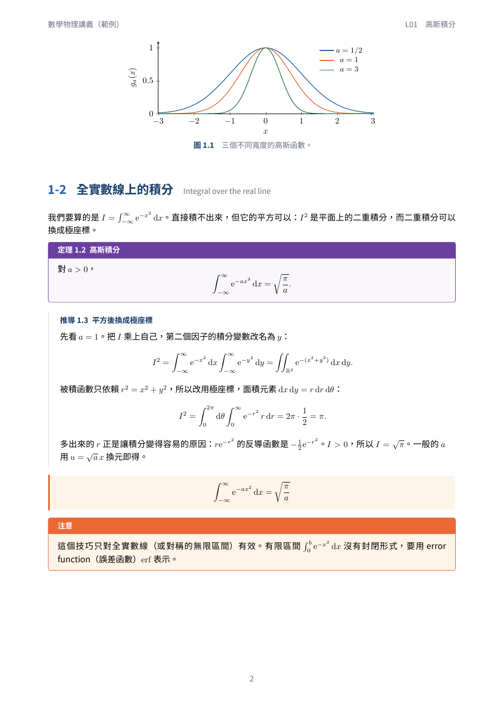
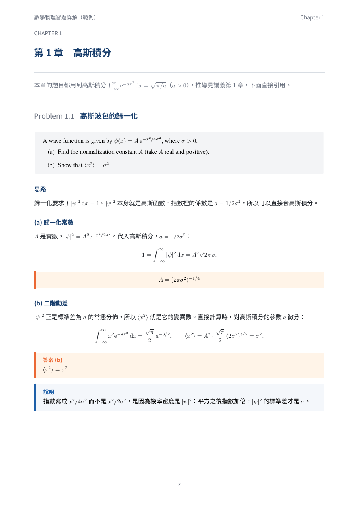

# 中文理工講義與習題詳解 LaTeX 版型 · LaTeX Lecture Templates

[English](README.md) | **繁體中文**

兩套 XeLaTeX 版型，給繁體中文的理工科教材使用：

- **`styles/codex_notes.tex`**：講義。章首標頭、帶英文副標的編號節標題、共用一組編號的定義／定理／推導／例題區塊、重點結果框、章首問題框、注意框與延伸框。
- **`styles/codex_solutions.tex`**：習題詳解。章首標頭、會列入目錄的題目標題、灰底襯線字的英文原題框、中文詳解內文，以及結果框與說明框。

兩套共用同一種外觀：A4、10 pt `article`、四邊 2 cm、行距 1.3、中英文都用 Noto Sans TC、段落不縮排、深藍標題、藍色點綴、淺橘重點結果框。

| 講義 `codex_notes.tex` | 詳解 `codex_solutions.tex` |
|---|---|
|  |  |

## 目錄

- [需要什麼](#需要什麼)
- [字型](#字型)
- [快速開始](#快速開始)
- [在自己的檔案中使用](#在自己的檔案中使用)
- [講義版型說明](#講義版型說明)
- [詳解版型說明](#詳解版型說明)
- [色票](#色票)
- [排版細節](#排版細節)
- [專案結構](#專案結構)
- [測試](#測試)
- [疑難排解](#疑難排解)
- [授權](#授權)

## 需要什麼

- **XeLaTeX。** 版型用到 `fontspec` 與 `xeCJK`，不支援 pdfLaTeX 與 LuaLaTeX。範例以 TeX Live 2026 編譯。
- **LaTeX 套件**（標準 TeX Live 安裝都有）：
  - 兩套共用：`fontspec`、`xeCJK`、`amsmath`、`amssymb`、`amsthm`、`mathtools`、`geometry`、`booktabs`、`longtable`、`array`、`tabularx`、`graphicx`、`float`、`enumitem`、`setspace`、`xcolor`、`fancyhdr`、`needspace`、`tcolorbox`（`most` 程式庫）、`titlesec`、`titletoc`、`hyperref`；
  - 講義另外用到：`etoolbox`、`caption`、`tikz`、`pgfplots`（設定 `compat=1.18`，需 pgfplots 1.18 以上）、TikZ 程式庫 `arrows.meta`、`calc`、`positioning`、`decorations.pathreplacing`，以及 pgfplots 程式庫 `fillbetween`；
  - 詳解另外用到：TeX Gyre Termes 的 OpenType 字型（`texgyretermes-*.otf`），TeX Live 已內建。
- **Noto Sans TC**（`NotoSansTC-Regular.ttf`、`NotoSansTC-Bold.ttf`），見下節。

## 字型

下載 [Noto Sans TC](https://fonts.google.com/noto/specimen/Noto+Sans+TC)（SIL Open Font License），從壓縮檔的 `static/` 資料夾把下面兩個檔案複製到 `fonts/`：

- `NotoSansTC-Regular.ttf`
- `NotoSansTC-Bold.ttf`

字型檔不進版本控制（見 [fonts/README.md](fonts/README.md)）。

字型資料夾由巨集 `\codexfontpath` 指定，結尾要有 `/`，而且要在載入版型**之前**設定：

```latex
\def\codexfontpath{C:/path/to/Noto_Sans_TC/static/}
```

- `../fonts/` 這類相對路徑，以執行 XeLaTeX 的資料夾為準。
- `\codexfontpath` 設成空白時，依檔名在 TeX 搜尋路徑與目前資料夾尋找字型。
- `codex_notes.tex` 內建的預設資料夾只存在於作者的電腦上，所以請一定自己設定 `\codexfontpath`（範例都有設定）。
- `codex_solutions.tex` 本身不設定字型，而是執行 `\input{fonts.tex}`，TeX 會在目前資料夾或 TeX 搜尋路徑裡找這個檔案。[examples/fonts.tex](examples/fonts.tex) 可以直接使用，它同樣讀取 `\codexfontpath`（預設 `../fonts/`）。

字型分工：Noto Sans TC Regular 同時是主字型、中文字型、斜體與等寬字型；Noto Sans TC Bold 是粗體與粗斜體。因此斜體文字會以正體排出。詳解版型的英文題目框使用 TeX Gyre Termes（一般、粗體、斜體、粗斜體，縮放 1.04）。

## 快速開始

1. 把 `NotoSansTC-Regular.ttf`、`NotoSansTC-Bold.ttf` 放進 `fonts/`。
2. 在 `examples/` 資料夾裡編譯範例：

   ```bash
   cd examples
   latexmk -xelatex notes_example.tex
   latexmk -xelatex solutions_example.tex
   ```

   不想讓中間檔留在 `examples/`，可以加上 `-outdir=../build`（`build/` 不進版本控制）。兩個範例各產生 3 頁的 PDF。

[examples/notes_example.tex](examples/notes_example.tex)（高斯積分的短章）與 [examples/solutions_example.tex](examples/solutions_example.tex)（兩道詳解）用到了大部分功能，可以直接複製來改。

## 在自己的檔案中使用

### 講義

```latex
\documentclass[10pt,a4paper]{article}
\providecommand{\codexfontpath}{../fonts/}   % 字型資料夾，結尾要有 /
\newcommand{\coursename}{數學物理講義}        % 頁首左側
% 可選參數放這裡（見下文）
\input{../styles/codex_notes.tex}
\setuplecture{1}{高斯積分}   % 章號、章名
\coursekeepblocks            % 選用：不讓節標題落在頁底

\begin{document}
\thispagestyle{empty}
\lecturehead{\coursename\quad L01}{高斯積分}
\tableofcontents
\booksection{高斯函數}{The Gaussian function}
...
\end{document}
```

### 詳解

```latex
\documentclass[10pt,a4paper]{article}
\providecommand{\codexfontpath}{../fonts/}
\input{../styles/codex_solutions.tex}       % 從目前資料夾讀 fonts.tex
\courseheader{數學物理習題詳解}{Chapter 1}

\begin{document}
\tableofcontents
\chapterhead{CHAPTER 1}{第 1 章　高斯積分}
\problem{1.1}{高斯波包的歸一化}
\begin{statement}
A wave function is given by ...
\end{statement}
\subsection*{思路}
...
\keyresult{$A=(2\pi\sigma^2)^{-1/4}$}
\end{document}
```

`../styles/`、`../fonts/` 是依本 repo 的資料夾配置寫的，請改成你實際放檔案的位置。

## 講義版型說明

### 設定

| 指令 | 位置 | 作用 |
|---|---|---|
| `\coursename` | 在 `\input` 之前定義（`\setuplecture` 需要它） | 課程名稱，印在頁首左側 |
| `\setuplecture{n}{章名}` | `\input` 之後 | 設定章號與章名。節號為 `n-1, n-2, …`；式號、圖號、表號與區塊號為 `(n.1), (n.2), …`；頁首左側是 `\coursename`，右側是 `L0n　章名` |
| `\coursekeepblocks` | `\input` 之後 | 每個 `\section` 前要求 12 行空間、每個 `\subsection` 前 8 行（`\Needspace*`），不夠就換頁 |

沒有呼叫 `\setuplecture` 時沒有頁首，區塊編號為 `0.k`。頁尾一律是置中的灰色頁碼。

### 可選參數（在 `\input` 之前定義）

| 巨集 | 預設 | 意義 |
|---|---|---|
| `\codexfontpath` | 作者本機的資料夾 | 字型資料夾，見[字型](#字型) |
| `\codexsecsep` | `-` | 章號與節號間的分隔符（`1-2`） |
| `\codexlecturetag` | `L01`、`L02`… | 帶一個參數的巨集，決定頁首章號的格式，例如 `\newcommand{\codexlecturetag}[1]{第#1講}` |
| `\codextoclabelwidth` | `2.6em` | 目錄中節號的寬度 |

### 標題

| 指令 | 結果 |
|---|---|
| `\lecturehead{小字}{章名}` | 取代 `\maketitle` 的章首標頭：一行灰色小字、18 pt 粗體深藍章名、一條細線 |
| `\booksection{中文標題}{English title}` | 編號的節。英文副標以灰色小字放在同一行，放不下時整段移到下一行；很長的副標不斷字。目錄只列中文標題 |
| `\plainsection{標題}` | 不編號、但會列入目錄的節（引導、總結） |
| `\section`、`\subsection` | 一般指令；節標題為 Large 粗體深藍加藍色節號，小節標題為粗體深藍、不顯示編號 |
| `\tableofcontents` | 標題為「目錄」，只列到節（`tocdepth` 1），附點線導引 |

### 區塊

`definition`、`theorem`、`derivation`、`example` 共用一個計數器，第 1 章依出現順序編為 1.1、1.2、1.3……。它們都可加選用標題 `[...]`、可以跨頁，放在框內的 `\label` 會記成區塊編號。

| 環境／指令 | 外觀 |
|---|---|
| `\begin{definition}[標題]` | 藍色標題列的框：「定義 n.k 標題」 |
| `\begin{theorem}[標題]` | 紫色標題列的框：「定理 n.k 標題」 |
| `\begin{derivation}[標題]` | 不加框，左側灰色細線，小標「推導 n.k 標題」 |
| `\begin{example}[標題]` | 不加框，左側綠線，小標「例 n.k 標題」 |
| `\begin{solution}` | 例題的解，接在 `example` 之後：綠色「解」字，不加框 |
| `\begin{note}[標題]` | 橘色框，標題「注意 標題」（不編號） |
| `\begin{extension}[標題]` | 灰底框、灰色小字，小標「延伸 標題」（不編號） |
| `\chaptergoal{內容}` | 灰底框，小標「本章問題」，放章首的問題 |
| `\keyresult{數學式}` | 置中的重點結果，淺橘底加左側橘條。參數**只能放數學式**，會以 `$\displaystyle ...$` 排出 |

`example` 與 `derivation` 前要求 6 行空間，`definition` 與 `theorem` 前要求 5 行，避免區塊小標單獨落在頁底。

### 其他設定

- 圖說：圖、表名稱為「圖」「表」；圖說為灰色小字，編號為深藍粗體。
- 條列：`itemize` 用藍色圓點，`enumerate` 用藍色 `1.`。
- 段距 0.55 em、不縮排、避免孤行與寡行、`\raggedbottom`、允許顯示式跨頁（`\allowdisplaybreaks[2]`）。
- 連結：`hyperref` 彩色連結（內部連結深藍，網址與文獻藍色）。
- 已設定 `\pgfplotsset{compat=1.18}`，可以直接畫 `tikzpicture`／`axis` 圖（講義範例中的圖即是）。

### 記號巨集

| 巨集 | 結果 |
|---|---|
| `\dd` | 正體微分 d，間距正確：`\dd x` |
| `\e` | 正體 e |
| `\avg{x}` | 自動調整大小的 $\langle x\rangle$ |
| `\Order` | 表示數量級的花體 O |

## 詳解版型說明

### 設定

| 指令 | 作用 |
|---|---|
| `\courseheader{左}{右}` | 頁首左右兩側的灰色小字 |
| `\codexsolutionsprehyperref` | 選用；在 `\input` 之前定義，例如 `\def\codexsolutionsprehyperref{\RequirePackage{siunitx}}`，用來載入必須在 `hyperref` 之前的套件 |

頁尾是置中頁碼。節標題不自動編號。

### 標題

| 指令 | 結果 |
|---|---|
| `\chapterhead{CHAPTER 1}{第 1 章　章名}` | 另起一頁；灰色小字、16 pt 粗體深藍章名、細線。以章層級（藍色粗體）列入目錄 |
| `\problem{1.1}{中文題名}` | 題目標題：灰色「Problem 1.1」接粗體深藍題名（large）。前面要求 10 行空間，不夠就換頁。以縮排項目列入目錄 |
| `\subsection*{思路}`、`\subsubsection*{...}`、`\paragraph{...}` | 詳解內的小標：粗體深藍；`\paragraph` 接排在段首。請用加星號的形式，目錄就只列章與題目 |
| `\tableofcontents` | 標題為「目錄」；頁碼欄加寬到 2.2 em，三位數頁碼也放得下 |

### 框

| 環境／指令 | 外觀 |
|---|---|
| `\begin{chapterintro}` | 灰色文字的章首說明 |
| `\begin{statement}` | 英文原題，淺灰底、TeX Gyre Termes 字型。可以跨頁，續段右上角標「（續）」 |
| `\begin{resultbox}[標籤]` | 淺橘底、左側橘條；選用標籤（例如 `[答案 (b)]`）以橘色粗體小字印在內容上方。不跨頁 |
| `\keyresult{文字}` | 在文字模式中，參數置中放進 `resultbox`，數學要寫成 `$...$`（例如 `\keyresult{$A=1$}`）。在數學模式中，以橘色底標示該式（`\tcbhighmath`） |
| `\begin{notebox}[標題]` | 淺藍底、左側藍條，標題預設為「說明」；可以跨頁 |

### 記號巨集

`\dd`、`\e` 與講義相同。`\avg`、`\Order` 只在講義版型中定義。

## 色票

兩套版型都定義了下列 `xcolor` 顏色名稱，可以在內文與圖中使用：

| 名稱 | 色碼 | 用途 |
|---|---|---|
| `qblue` | `#1D5FA8` | 節號、條列符號、目錄的章項目、定義框、說明框（詳解） |
| `qnavy` | `#173D6B` | 標題、連結 |
| `qorange` | `#EB6834` | 結果框左條、注意框標題（講義） |
| `qorangebg` | `#FFF4E8` | 結果框底色 |
| `qgraybg` | `#F3F4F6` | 原題框、章首問題框、延伸框底色 |
| `qrule` | `#D8DDE3` | 細線、推導左線 |
| `qmuted` | `#6B7280` | 次要文字、頁首頁尾 |
| `qtext` | `#1F2329` | 內文 |

講義另有 `qgreen`（`#2E7D4F`，例題與解）、`qpurple`（`#6B3FA0`，定理），以及別名 `qgray`（= `qmuted`）、`qlight`（= `qgraybg`）。詳解另有 `qgraybar`（`#8A929C`）。

## 排版細節

- **英文撇號。** xeCJK 預設把 `‘ ’`（U+2018／U+2019）當全形中文標點，Noto Sans TC 的這兩個字形也是全寬，*Ampère's* 這類字的撇號後面因此多出空隙。兩套版型都把這兩個字元改回西文字元，並對主字型開啟比例寬字形（`+pwid`）。中文標點不受影響；中文引號請用「」。
- **跨頁框之後的文字顏色（講義）。** 可跨頁的框剛好在頁底結束時，`xdvipdfmx` 的顏色堆疊可能錯位，之後的內文變成白字。講義版型在每個 `definition`、`theorem`、`note`、`derivation`、`example`、`extension` 結束後重設一次內文顏色。
- **編號框內的 `\label`（講義）。** 放在編號區塊裡的 `\label` 記錄的是區塊編號（例如 `1.3`），不是外層的節號。

## 專案結構

```
.
├── styles/
│   ├── codex_notes.tex        # 講義版型
│   └── codex_solutions.tex    # 詳解版型
├── examples/
│   ├── notes_example.tex      # 講義範例（高斯積分）
│   ├── solutions_example.tex  # 詳解範例（兩題）
│   └── fonts.tex              # codex_solutions.tex 讀取的字型設定
├── fonts/
│   └── README.md              # 字型取得方式（字型檔本身不進版本控制）
├── docs/
│   ├── notes_preview.png
│   └── solutions_preview.png
├── LICENSE                    # MIT
├── README.md                  # 英文說明
└── README.zh-TW.md            # 本檔（繁體中文）
```

`.gitignore` 排除字型檔、`build/`、LaTeX 中間檔，以及 `examples/` 裡產生的 PDF。

## 測試

沒有自動化測試，檢查方式是編譯兩個範例（見[快速開始](#快速開始)）。以 TeX Live 2026 編譯時兩者都沒有錯誤，各產生 3 頁 PDF（詳解範例的 log 有一則關於書籤錨點的 `hyperref` 警告）。

## 疑難排解

| 問題 | 原因與處理 |
|---|---|
| `The font "NotoSansTC-Regular" cannot be found` | 沒有設定 `\codexfontpath`、結尾少了 `/`，或相對路徑與執行 XeLaTeX 的資料夾對不上。請在 `\input` 之前設定。 |
| `File 'fonts.tex' not found`（詳解） | 詳解版型從目前資料夾或 TeX 搜尋路徑讀 `fonts.tex`，把 `examples/fonts.tex` 複製到主檔旁邊。 |
| `Undefined control sequence \coursename` | 使用 `\setuplecture` 時要定義 `\coursename`。 |
| 區塊編號是 0.1、0.2 | 沒有呼叫 `\setuplecture{n}{...}`。 |
| `\keyresult` 報錯，或數學被當成文字 | 兩套版型不同：講義的參數是數學式（`\keyresult{E=mc^2}`），詳解的參數是文字（`\keyresult{$E=mc^2$}`）。 |
| 用 pdfLaTeX 時 `fontspec` 報錯 | 請用 XeLaTeX 編譯（`latexmk -xelatex`）。 |
| 重新定義 `\codexlecturetag` 後頁首出錯 | 它必須接受一個參數（章號）。 |

## 授權

版型與範例以 [MIT License](LICENSE) 釋出。Noto Sans TC 採 SIL Open Font License，需另外下載；TeX Gyre Termes 隨 TeX Live 散布。
